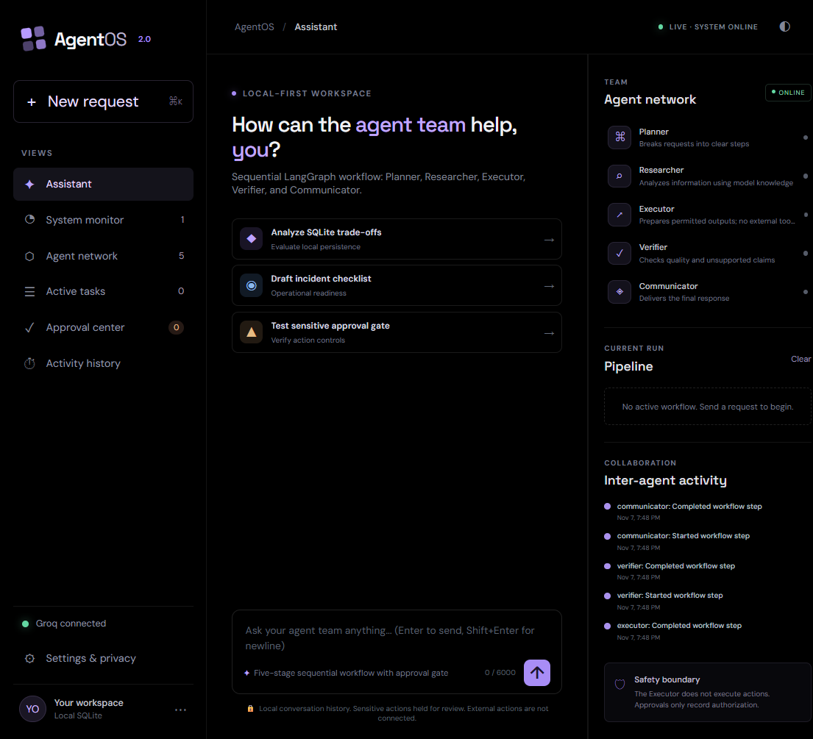
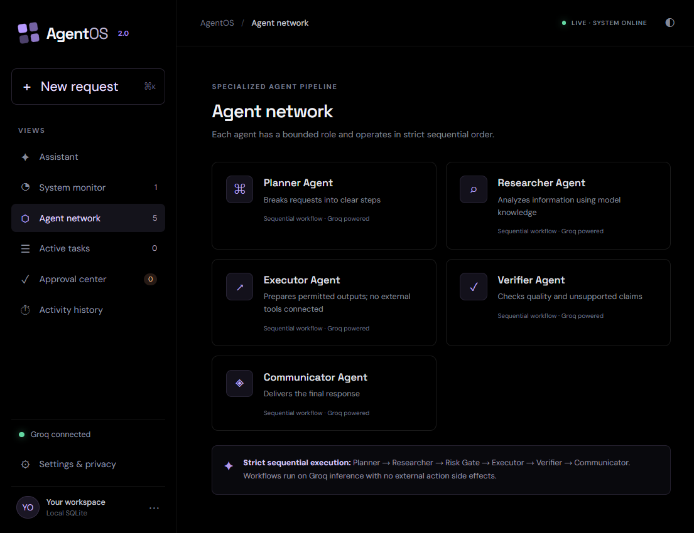

# AgentOS 2.0

AgentOS is a local-first AI workspace and system monitor built with vanilla HTML, CSS, and JavaScript; FastAPI; SQLite; Groq; and sequential LangGraph workflows.

## Screenshots

### Assistant workspace



### Agent network



## Requirements

- Python 3.11 or newer
- A Groq API key
- `psutil` (installed from `requirements.txt`)

## Run locally

From the project directory, create and activate a virtual environment, install dependencies, configure the API key, and start the server:

```powershell
py -m venv .venv
.\.venv\Scripts\Activate.ps1
python -m pip install -r requirements.txt
Copy-Item .env.example .env
```

Edit `.env` and set `GROQ_API_KEY` to your own key (and optionally `GROQ_MODEL=openai/gpt-oss-120b`). Alternatively, you can connect Groq directly from the **Settings & privacy** tab in the web UI. The backend uses the model for the orchestrator and the monitor diagnostic workflow.

```powershell
uvicorn app.main:app --host 127.0.0.1 --port 8000
```

Open [http://127.0.0.1:8000](http://127.0.0.1:8000). Keep the server bound to localhost: authentication is not implemented, so this foundation is intended for a single trusted user on their own machine.

Without `GROQ_API_KEY`, the dashboard and local history remain available, but chat returns a visible configuration error rather than simulating agent output.

## Project structure

| File | Purpose |
| --- | --- |
| `app/main.py` | FastAPI routes, request validation, websocket broadcasts, workflow/task coordination, and monitoring API routes. |
| `app/agents.py` | Planner, Researcher, Executor, Verifier, and Communicator LangGraph nodes and approval gate. |
| `app/database.py` | SQLite schema and persistence helpers for conversations, messages, tasks, activity, preferences, monitoring samples, alerts, and diagnostics. |
| `app/monitoring/system_monitor.py` | Host CPU, memory, disk, and process uptime measurements using psutil. |
| `app/monitoring/database_monitor.py` | SQLite integrity and database-size checks. |
| `app/monitoring/api_monitor.py` | Rolling API latency and server-error measurements. |
| `app/monitoring/ai_monitor.py` | Timed Groq model-list availability probe; agent run records capture per-agent response duration. |
| `app/monitoring/agent_monitor.py` | Agent execution status, duration, success/failure, and last-error summaries. |
| `app/monitoring/diagnostic_agent.py` | LangGraph diagnostic workflow that analyzes measured health and recent server errors. |
| `app/monitoring/service.py` | Periodic sampling, SQLite history, configurable alert evaluation, and live monitor events. |
| `static/index.html` | Accessible dashboard structure and views. |
| `static/styles.css` | Responsive dark-theme styles and layout. |
| `static/app.js` | Vanilla JavaScript UI, REST API integration, and live websocket updates. |
| `requirements.txt` | Python runtime dependencies. |
| `.env.example` | Example server-side configuration. |

SQLite is created automatically at `data/agentos.db`. Override the location with `AGENTOS_DATABASE_PATH`.

## Current capability and safety boundaries

- The five agents run sequentially and persist their task and activity status.
- The Researcher uses the model's existing knowledge; web search is not connected.
- The Executor prepares an answer or draft. No external action tools, accounts, or services are connected.
- Requests matching sensitive-action checks skip the Executor and are held in the Approval Center. Authorizing records approval only; it does not execute an action.
- There is no authentication. Run on localhost and do not expose this service to an untrusted network.
- Conversation deletion and history clearing are user-controlled and remove the associated SQLite records.

## API overview

- `GET /api/health`, `GET /api/agents`
- `POST /api/chat`
- `GET/POST /api/conversations`, `GET/DELETE /api/conversations/{id}`
- `GET /api/conversations/{id}/messages`, `DELETE /api/history`
- `GET /api/tasks`, `GET /api/approvals`, `POST /api/approvals/{task_id}`
- `GET /api/activity`, `GET/PUT /api/preferences`
- `GET /api/monitor/overview`, `GET /api/monitor/history?period=1h|6h|24h|7d`
- `GET /api/monitor/agents`, `GET /api/monitor/agents/history`
- `GET /api/monitor/alerts`, `POST /api/monitor/alerts/{id}/acknowledge`
- `GET/PUT /api/monitor/settings`, `GET /api/monitor/errors`
- `GET /api/monitor/diagnostics`, `POST /api/monitor/diagnose`
- `WS /ws` for agent progress, approval, and workflow events

## System monitoring

The monitor samples host CPU, memory, disk, backend uptime, SQLite integrity/size, API latency/error rate, Groq availability, and connected WebSocket clients every 15 seconds. Samples and API/agent events are stored in SQLite to support short-term trends and diagnostics.

The initial alert thresholds are 85% CPU, 85% memory, 90% disk, 1500 ms average API latency, and five WebSocket disconnects per five minutes. Users can change these values and opt into browser notifications when alarms trigger.

System diagnosis is user-triggered and requires Groq. The diagnostic LangGraph receives a real health snapshot and recent application errors, stores the report, and provides advisory recommendations on the dashboard.

The monitor exposes data for the local server process and host. It cannot alert while the backend itself is offline; the browser instead shows a lost live-connection status until it reconnects. As with the rest of AgentOS, this is a local-first monitoring prototype meant for trusted local use.
C:\Users\Dhanush\Pictures\Screenshots.png
C:\Users\Dhanush\Pictures\Screenshots.png

